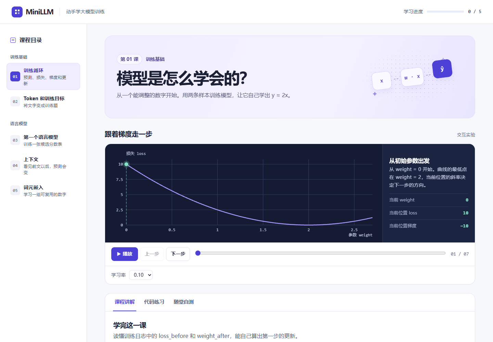
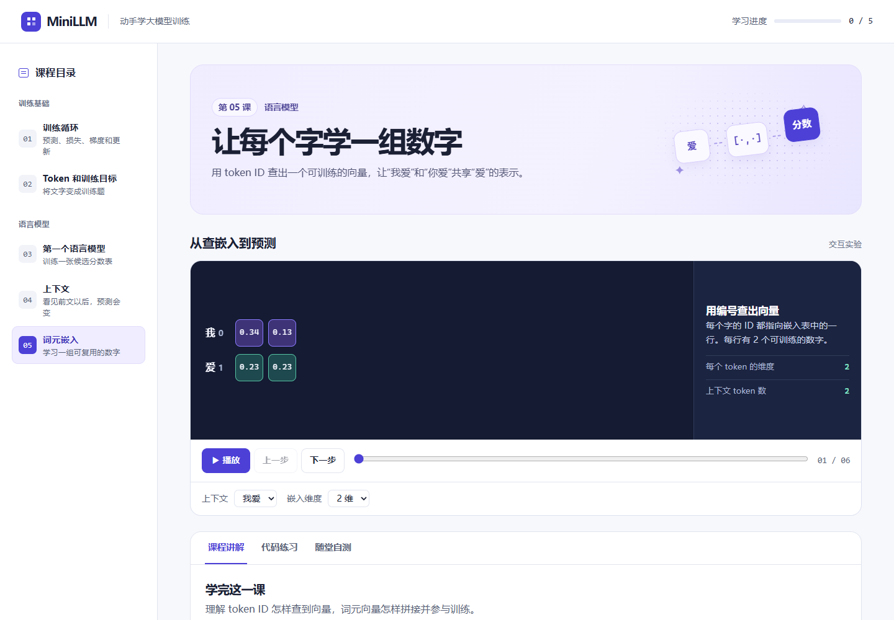

# MiniLLM · 动手学大模型训练

MiniLLM 是一套面向零基础学习者的中文 LLM 训练课程。课程从一个只有一个参数的 PyTorch 模型开始，用五个小实验讲清训练循环、词元与训练目标、下一个词元预测、上下文和词元嵌入。

**学习方式**是先在网页里逐步观察实验，再运行同一课的 Python 代码。每课附有修改代码的小练习、提示和两道带解析的自测题。网页支持桌面和手机布局。

## 网页截图

**训练循环。** 每前进一步，曲线上的点会随参数移动，右侧会显示当前位置的参数、损失和梯度。切换学习率可以比较更新路径。



**词元嵌入。** 可以切换“我爱”和“你爱”，观察两个上下文如何复用“爱”的向量，也可以把嵌入维度从 2 改成 3。



## 快速开始

### 打开课程网页

```bash
git clone https://github.com/huang16s/MiniLLM.git
cd MiniLLM
```

用浏览器打开 [`web/index.html`](web/index.html)。网页由 HTML、CSS 和 JavaScript 组成，可以离线使用。动画、讲解、示例代码和自测题都包含在项目里。

也可以从仓库根目录启动本地预览，然后在浏览器打开 `http://127.0.0.1:8000/`。

```powershell
py -3.12 -m http.server 8000 --bind 127.0.0.1 --directory web
```

在左侧目录选课。用「播放」「上一步」「下一步」或拖动时间轴控制实验。实验下方的选项可以切换学习率、样本、当前词元或嵌入维度。点击「标记为已完成」后，浏览器会记录学习进度。进度按浏览器和访问地址分别保存。

### 运行 Python 示例

示例使用 Python 3.12 和 PyTorch，在 CPU 上即可运行。运行与安装依赖时，请使用同一个 Python 解释器。

Windows PowerShell 里，从仓库根目录执行以下命令。如果已经能导入 `torch`，可以从最后一条命令开始。

```powershell
py -3.12 -m pip install torch --index-url https://download.pytorch.org/whl/cpu
py -3.12 -c "import torch; print(torch.__version__)"
py -3.12 -X utf8 .\MiniLLM\01_training_loop.py
```

macOS 和 Linux 可以使用 `python3`，并按操作系统选择 PyTorch 安装命令。安装后，从仓库根目录运行 `python3 MiniLLM/01_training_loop.py`。[PyTorch 官方安装指南](https://pytorch.org/get-started/locally/)

第 1 课运行时，第 1 步会显示 `loss_before=10.000000` 和 `weight_after=1.000000`。`loss_before` 是更新前算出的损失，`weight_after` 是更新后的参数。6 步之后，模型对输入 `3` 的预测约为 `5.9062`。

## 课程目录

| 课程 | 学到什么 | 动手练习 |
| --- | --- | --- |
| [01 · 训练循环](MiniLLM/01_training_loop.py) | 用预测、损失、梯度和参数更新解释 `y ≈ 2x` 是怎样学出来的。 | 把目标换成 `[3.0, 6.0]`，观察 `weight` 接近 `3` 的过程。 |
| [02 · Token 和训练目标](MiniLLM/02_tokens_and_targets.py) | 按字符切分并建立词表，把目标错开一位来构建下一词元预测数据。 | 换成“我爱学习，也爱练习”，检查重复出现的“爱”和“习”各用什么编号。 |
| [03 · 第一个语言模型](MiniLLM/03_bigram_model.py) | 用当前词元查出候选分数，理解 bigram、softmax 和交叉熵。 | 查看“爱”“我”“习”对应的概率，区分出现过的输入和只出现为目标的词元。 |
| [04 · 上下文](MiniLLM/04_context_model.py) | 比较只看一个词元与看两个词元，理解额外前文如何提供预测线索。 | 比较“我爱猫 / 你爱狗”和“我爱猫 / 我爱狗”两组训练样本。 |
| [05 · 词元嵌入](MiniLLM/05_token_embeddings.py) | 按词元 ID 查出可学习向量，再用向量拼接和线性层产生候选分数。 | 把嵌入从 2 维改成 3 维，验证两个词元拼接后得到 6 个数字。 |

建议每课先看一遍动画，然后自己做一次参数或样本改动。运行前先写下预测结果，运行后再对照输出和自测解析。

## 项目结构

```text
.
├── README.md
├── MiniLLM/                    # 五课的独立 Python 示例
│   ├── 01_training_loop.py
│   ├── 02_tokens_and_targets.py
│   ├── 03_bigram_model.py
│   ├── 04_context_model.py
│   └── 05_token_embeddings.py
├── web/                        # 可离线打开的课程网站
│   ├── index.html               # 网页入口
│   ├── styles.css               # 桌面与手机布局
│   ├── curriculum.js            # 课程讲解、练习和自测
│   ├── examples.js              # 网页展示的 Python 源码和嵌入实验快照
│   ├── labs.js                  # 实验计算、图表与动画
│   └── app.js                   # 课程导航、播放控件和学习进度
└── docs/
    └── screenshots/            # 本 README 使用的网页截图
```

网页里的训练循环、bigram 和上下文实验会在浏览器里计算每个演示步骤。词元嵌入实验展示预先运行 PyTorch 得到的快照，包含 2 维和 3 维两种配置。要修改训练算法或复现实验数值，可以直接运行 `MiniLLM/` 下对应的脚本。

## 后续学习路线

完成这五课后，可以从加权求和进入单头自注意力，接着学习位置嵌入和因果掩码，把它们接成 Transformer 块。下一阶段的目标是用小语料训练并保存一个能续写的迷你 GPT，再对照 MiniMind 的源码理解预训练和指令微调。LoRA 可作为后续选修。
